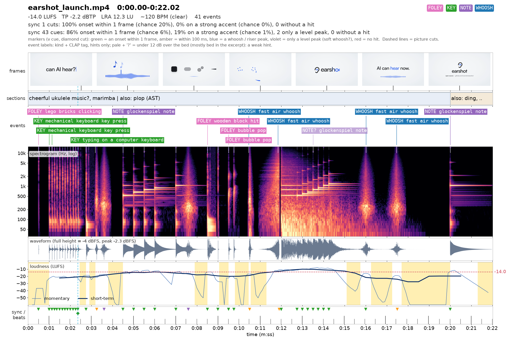

# earshot

**Ears for coding agents.**

<!-- launch video -->
[**Watch the 22 s launch film**](https://github.com/Leonxlnx/earshot/releases/tag/v0.1.0) - every sound in it was made
in code by `earshot forge`; no recordings, no music track.


AI coding agents can now write the code that renders a film, a product demo or a game. They still cannot hear what
they made. They cannot tell a premium key press from a cheap one, notice that a hit lands 80 ms after the cut, or
hear that the music swells in the wrong place.

earshot turns sound into evidence an agent can reason about: what a file sounds like in words, how well it fits a
description, the best moment inside a long recording, whether it is a real recording or code-synthesized, a
second-by-second listening transcript of a whole film, an annotated picture of it, and a scorecard against
professional launch films. It runs locally on CPU, as a CLI, a Python API and an MCP server.

With ears, an agent can also **make its own sounds in code** and improve them by listening (`earshot forge`), and
**translate a recording into code** it can vary (`earshot fit`). Both below.

**New in 0.4: the sound of a music-led launch film.** 51 new sounds made in code for the soft, short, mid-register
style those films use: rounded UI pops, wood and plastic knocks, short cut hits and sub hits with a kick, gated
glockenspiel / celesta / marimba notes and chime runs, water drops, camera shutters, reverse cymbals, a thump-whoosh,
short dark risers, bright swishes, burst glitches and mid dings (the bank now holds 252). A new `launch` kit preset
mixes every effect against the music bed instead of at a fixed level, says where each one sits against the cut (taps
lead it, whoosh peaks land after it) and how close a run may go. And `earshot fit` was re-made against professional
sound effects and measured on held-out clips ([below](#earshot-fit-audio-to-code)).

**New in 0.3: sound for code-made films.** A bank of sound effects stored as code that render by id in seconds,
with no models and no network: `earshot sfx` aims a whoosh, hit, click or note at a moment in the picture, and
`earshot kit` renders a whole film's effects with measured sync points ([below](#sound-for-films-bank-sfx-kits)).

```
$ earshot describe enter.ogg
  0.56 s short transient (attack 3 ms, decays in 190 ms). Sounds most like: a single mechanical keyboard key press
  (z +5.4), a soft key release click (z +3.6) ... [clear reading]. peak -0.1 dBFS, brightness 1.5 kHz ...

$ earshot match key.ogg "a deep thocky mechanical keyboard press" --alts "a clicky blue switch keyboard" "a mouse click"
  -> strong (z +3.7; would rank #2 among 322 vocabulary descriptions) ...

$ earshot find keys.ogg "a single mechanical key press" --top 4
  0:03.94-0:04.19 (0.24 s stroke, z +4.1 strong); 0:10.60-0:10.86 ...

$ earshot critique film.mp4
  VERDICT: close - 21 of 23 scored metrics in range ... FIX FIRST: 1. [major] nothing reaches body level until 0:01.01 ...
```

## What it does

| command | what an agent gets |
|---|---|
| `describe FILE` | what it sounds like: calibrated tags (z) with the closest alternative readings, AudioSet labels, measurements |
| `match FILE QUERY [--alts ...]` | how well a description fits: cosine, z among the vocabulary, a verdict (strong / plausible / weak / no match) with held-out evidence |
| `rank QUERY PATHS...` | many candidate files sorted by a description (pick the best download) |
| `find FILE QUERY` | the best moments inside a long recording, as sample trims (start / end seconds) |
| `compare FILE --refs DIR` / `ab A B` | nearest reference recordings and typicality; A/B two sounds or two trims, the differences in words |
| `realness FILE...` | real recording / pro-produced vs code-synthesized, with evidence and per-window scores |
| `timeline FILE [--video V] [--cues C]` | the listening transcript: events (time, level, tag), sections, loudness, beat grid, sync of sound to picture cuts and cue frames |
| `sheet FILE -o out.png` | an annotated PNG (video frames, sections, labelled events, spectrogram, waveform, loudness, sync markers) for agents that read images |
| `critique FILE [--video V]` | a launch-video scorecard against a profile of 7 professional launch films, with timestamped fixes |
| `profile REFS... -o p.json` | build your own reference profile from films you admire |
| `measure FILE` | objective measurements only (no models): LUFS, true peak, LRA, envelope, spectrum, tempo / key |
| `forge RECIPE --refset CAT` | make a sound in code and improve it by listening (see below) |
| `fit FILE -o recipe.py` | translate a recording into a forge recipe module that re-renders it, with knobs and morphs (see below) |
| `sfx render ID -o x.wav` | a sound from the shipped bank of 252, aimed at the picture (`--dur`, `--apex`, `--pitch`) and audited; `sfx list`, `sfx check` (no models) |
| `kit init / render / check` | a film's sound kit: one bank sound per role, rendered into cached takes with measured onset / peak / end; the `launch` preset places each role against the music bed and the cut (no models) |
| `gallery DIR -o page.html` | one static HTML listening page of forge outputs: players, spectrograms, numbers |
| `llm FILE --yes-upload` | optional audio-LLM critique (Gemini), only with your own key and explicit consent |
| `mcp` | the same tools as an MCP server for Claude Code and other agents |
| `doctor [--load]` | check the install, models, data files and CPU settings |

Every command prints a plain-language summary first; `--json` gives the full result, `--out f.json` saves it. Errors
are one line on stderr (`earshot <command>: error: ...`, exit 1). Each CLI call is a new process and loads the models
(~20-40 s) before it answers (`measure`, `sfx` and `kit` load none): for more than a few calls use the MCP server
(models stay loaded) or one Python script with `from earshot import api`.

What an agent sees when it listens to that film with `earshot sheet` (frames, labelled sound events, spectrogram,
loudness, sync to the beat):



## Make sounds: earshot forge

Listening makes iteration possible. The agent writes a sound as code: a **recipe** of physical synthesis (modal
resonators, contact excitations, filtered noise, a computed room and a microphone; no recorded audio inside). The
forge renders candidates from the recipe's parameters, and a **critic** built from earshot scores each one:
description match against named confusions, realness, closeness to real reference recordings and measured shape, then
model-free penalties against the references: 1/3-octave tonal balance, the spectro-temporal envelope (a tail that dies
too fast shows here), artifacts (clicks, aliasing, DC / infrasound, harsh resonances, comb ring, cut tails, clipping)
and polish (attack, onset snap, tail smoothness). A cheap model-free **pre-screen** ranks many renders with the same
measurements, so the models only hear the best; an evolutionary **search** keeps the best and mutates them. Then the
agent reads the critic's words ("sounds like: a cork pop, a glass ting", "decay +2.4 outside the refs", "bumpy tail"),
looks at spectrograms next to the references, rewrites the recipe, and runs it again.

```bash
earshot forge --list                             # the recipes (click, impact, keypress, pop, whoosh, ...) + refsets
earshot forge keypress --refs path/to/real/keypresses/ --budget 144 --variants 4 --dir made/keypress
earshot forge whoosh --refset whoosh_fast --budget 96 --dir made/whoosh      # a reference set's 'forge' split
earshot forge whoosh --target "a fast crisp air whoosh" --alts "a wind gust" "a sword swing" \
  --refs path/to/real/whooshes/ --mode real --dir made/whoosh
earshot forge --render keypress --params made/keypress/report.json --seeds 1 2 3 --dir made/again
```

Output (`--dir`): the best diverse sounds as WAVs; `report.md` (what was asked, the search per generation, each pick in
the critic's words, the measured gap to the references); `compare.png` (each pick's spectrogram, envelope and
1/3-octave balance next to its nearest reference); `audition.wav` (made, ref, made, ref ... to listen in pairs);
`report.json` with every candidate's parameters and scores, the same critic's scores of the real references
(leave-one-out) and held-out AudioSet tags. Picks are re-rendered on new seeds (`--robust`, default 3) and must differ
in parameters and in sound. Reference sets (`earshot/forge/refsets.py`) are split by source into a 'forge' side the
search may use and a 'bench' side only the fixed benchmark (`eval/forge/bench.py`) hears. The DSP toolkit for recipes:
`earshot/forge/dsp.py` (sources: modal, noise, air, sweeps, Shepard risers, sub drops, bells, FM; layering) and
`earshot/forge/fx.py` (reverb, saturation, transient shaping, limiter, EQ match, Doppler, filters, glitch, granular).
In Python: `from earshot.forge import forge`.

**forge v2 (0.2.0).** Recipes come as families of named characters: 34 motion-design categories (whooshes, swishes,
swipes, risers, downlifters, zips, impacts, sub drops, logo stings, clicks, taps, toggles, hover ticks, pops,
notification dings, shimmers, glitches, key presses), 16 of them modelled on the designed effects of professional
launch films ([docs/motion-sfx-study.md](docs/motion-sfx-study.md)), 4-6 variants each. A fixed benchmark scores them
against held-out recordings the forge never heard. Against v1 on it: variants are no longer near copies (CLAP cosine
between variants 0.89-0.97 -> 0.71-0.85 in the five categories v1 had; real sets 0.52-0.77), tails that died too fast
now reach the real length (click t40 0.56 -> 1.44 x the bench median, fast whoosh 0.51 -> 0.88), and the tonal
balance is closer in 3 of those 5 (key press 8.2 -> 7.4 dB, fast whoosh 8.6 -> 6.2, impact 6.7 -> 4.4). Across all
34, the made balance is at least as close to the held-out recordings as a second set of real recordings in 18 of the
21 categories that have a number, and every final re-renders from its `report.json` (`earshot forge --check`). The
model checks that v1 had saturated fell. A clean blind-test kit for the v2 sounds is `eval/forge/blind_v2.py`; no v2
score is published yet (docs/SFX.md says the same), so the blind test below is the v1 one. What changed, every number, and what is still weak: [docs/FORGE_V2.md](docs/FORGE_V2.md).

The reference recordings are licensed and not in this repo, so `--refset` needs a local registry: bring your own refs
with `--refs DIR`, or lay them out as described in `earshot/forge/refsets.py`. Without refs the critic runs in
designed mode (realness reported, not required). The CLI defaults changed in 0.2.0 (pre-screen, seed bank, robust
re-renders, the recipe's reference set); the Python `forge()` defaults still reproduce v1. See
[CHANGELOG.md](CHANGELOG.md).

**Blind test (v1 recipes).** A key press, a UI click, a pop, a fast whoosh and an impact were made from scratch in
code and played blind next to real recordings of the same kind of sound. The author picked the made one correctly **8 times out
of 15**: a coin flip. Only the made impact was spotted (its tail dies too fast). One listener and 15 trials is a small
test, not a proof; it says the made sounds are no longer easy to tell from real ones.

**Honest limits (Goodhart).** The search optimises earshot's own models, and those can be pleased without the sound
getting better. After a search the made sounds pass every model check, held-out ones included, so the model checks
stop telling made from real; the 1/3-octave measurement still can. The realness model is easy to fool (a modal
resonator plus a room and a noise floor reads "real"). Judge a made sound by the model-free measurements,
spectrograms next to the references, robust re-renders, and a human blind test.

## earshot fit: audio to code

`earshot fit` translates a recording into code by analysis by synthesis. It fits a small synthesis model with readable
parameters (ringing modes, tracked partials, a time-varying noise gesture, or a layered hybrid of them) until its
render matches the recording, then writes the model as a forge recipe module whose `render()` makes the sound. The
module stores the structure of the sound, not its samples, so it can make new takes, variations (size, damping,
pitch, brightness, decay, ...) and morphs between two recordings.

```bash
earshot fit click.wav -o made/click_fit.py --report    # recipe + its render + side-by-side spectrogram + metrics
python made/click_fit.py 3 take3.wav                   # the module renders on its own (seed 3)
earshot fit --morph a.wav b.wav --amount 0.5 -o made/ab_morph.py
earshot fit --forge made/click_fit.py --budget 96 --dir made/click_variations   # critic-searched variations
```

Measured with the earlier engine (0.2-0.3) on 12 real recordings (2 each of click, key press, pop, impact, fast
whoosh, notification): median CLAP cosine 0.945 between each recording and the render of its generated code (minimum
0.881), and the same top `earshot describe` tag in 10 of 12. In our 12-trial blind test of that engine (recording vs
render, loudness-matched, random order) the listener could not tell which clip was the recording. One listener is a
small test, not a proof. Neither was re-run on 0.4.0, whose choice changed (the gesture model, the CLAP margin rule,
the gate, the finish); its benchmark below is measurement only (CLAP and the mel gap are proxies; nobody listened).
The renders are close, not identical: onsets, tone balance and noise texture still differ measurably; the selection
weights were set on the same 12 recordings; zips, long glides and swipes are untested (the benchmark below covers
risers, shimmers, swells and camera moves). A fit is a derivative of its recording, so keep the source's licence with
the recipe. Limits: [docs/FIT.md](docs/FIT.md#limits-honest).

**Re-making professional sound effects (0.4).** The replication benchmark (`eval/forge/replicate.py`) fits a private
set of licensed reference clips (116 clean one-gesture effects in 24 categories; not in the repo: no audio, no clip
name and no per-clip model ships; aggregate measurements of them (medians, IQRs), CLAP cosines to them and parameters
tuned toward them do) and measures each fit and four takes against its clip. 0.4 adds a noise-gesture model (tones plus
air), stereo width and decorrelated tails, music-bed stripping decided by analysis by synthesis, gates for pulses
and hard stops, and takes that keep the fit's structure. It was tuned on 78 dev clips; two held-out sets were each
opened once:

| clips | earshot 0.3 | earshot 0.4.0 |
|---|---|---|
| dev (78): median CLAP, fits graded high | 0.884, 19 | 0.921, 40 |
| held-out (38): median CLAP, high | 0.878, 7 | 0.909, 14 when opened (first-round engine); 0.903, 14 for 0.4.0 on the opened set |
| fresh held-out (28, harder: more music under the effects): median / mean CLAP | 0.853 / 0.844 | 0.851 / 0.860 |
| fresh held-out: mel gap to the clip, grades high / good / fair / poor | 0.87 dB, 2 / 6 / 14 / 6 | 0.58 dB, 5 / 6 / 13 / 4 |
| fresh held-out: takes that pass the take check, take CLAP | 8, 0.809 | 7, 0.863 |

On the harder fresh set 0.4.0 is level with 0.3 on the median and ahead on the mean, the spectrogram gap and the
grades (up on 7 clips, down on 2), but fewer of its takes pass, the bed check can drop a bed the fit needed, and
onsets came out blunter (1.00 octave off against 0.53). Every number and what is still weak:
[docs/FIT.md](docs/FIT.md#the-replication-benchmark-04).

## Sound for films: bank, sfx, kits

The forge's delivered sounds ship as a bank of 252 that renders by id, with no models and no network: 183 forge v2
finals (34 categories), each stored as its render block and re-rendering its delivered WAV to one 24-bit step; 51
sounds made in 0.4 from new recipes for music-led launch films; three tuned kalimba voices; and 15 sounds fitted from
CC0 recordings (clicks, a tick, pops, touches, keys, a snap, a bell, a whoosh; credits in
[docs/CREDITS_FIT.md](docs/CREDITS_FIT.md)). A film pipeline renders from it in seconds; searching and fitting new
sounds stay offline steps.

**The 0.4 families**, each a handful of different members, all made from recipes (none copied: the largest CLAP
cosine of any of them to the reference clips is 0.84, the bar 0.96) and each with its measured profile and take
audit in the bank:

| family | members | for |
|---|---|---|
| `ui_pop` | soft, step, boop, blip, fall, wide | rounded mid pops (0.12-0.2 s, 550-1030 Hz, 13-44 ms onsets): chips, bubbles, rows arriving |
| `knock` | wood, plastic, snap, desk, double | mid-band wood and plastic knocks (0.1-0.2 s) |
| `cut_hit` | sub, kick, punch, rumble, air | short sub hits with a kick, a punchy cut hit (0.2-0.5 s; rumble 1.4 s) |
| `mallet` | glock, celesta, marimba, pluck; flourish, up4 | gated mallet notes (~0.35 s, glock and celesta wide), a soft pluck, chime runs; tuned by `--pitch` |
| `drip` | drop, bubble, plink, bloop, tiny | water drops whose pitch rises (the audit allows a bubble its climb) |
| `shutter` | dslr, snap, mirror, film, quick | camera shutters: a two-stage mechanical click for snap zooms and whip-cuts |
| `reverse_swell` | cymbal, ring, dark, short, breath | reverse cymbals and swells that peak just after a cut |
| new members | whoosh_big thump x3, riser dark / build / snatch, swish bright / flick, whoosh_fast whip, glitch burst / mid / chirp, notify mid_tine / mid_wood | a thump-whoosh, short dark risers without a synth sweep, bright swishes and a falling whip, glitches that hit first, rounded mid dings |

```bash
earshot sfx list --kind whoosh                                      # ids, lengths, peak times, cue kinds, knobs
earshot sfx render whoosh_fast/crisp -o w.wav --dur 0.8 --apex 0.32  # a new take aimed at a move (--seed N)
earshot sfx render pluck/kalimba -o e5.wav --pitch E5                # tuned through the recipe's own f0
earshot sfx check w.wav                                              # clicks, cut tails, clipping, ring, rising glides
earshot kit init --preset calm -o audio/kit.json                     # calm | crisp | minimal | launch
earshot kit render audio/kit.json --out audio/kit                    # takes + kit.lock.json (measured onset / peak / end)
earshot sfx render ui_pop/soft -o pop.wav --pitch A4                 # a 0.4 sound, tuned
```

- **Knobs** edit each recipe's own parameters, never resample: `dur` lands exactly, `apex` puts a whoosh's loudest
  moment within 5 ms of the target (measured within 2.5 ms), `pitch` takes a note name or Hz (pluck E5, a bell G5, a
  sub drop G1 measure 0 cents off); noise sounds refuse a pitch and say why.
- **The audit** (`earshot sfx check`, run on every render) is measurement only: clicks, cut tails, clipping, DC, comb
  ring, a re-rising tail, a tonal pitch that climbs more than 4 semitones (the rising "synth whip"), and for hits,
  stacked attacks or a build before the hit (a water drop's rising bubble is allowed). 236 of the 252 sounds are clean
  at their own seed (all 51 of 0.4's); the presets use none of the others.
- **Kits** name one sound per role (tick, hit, whoosh.short, key, bell, text ...). `kit render` writes deterministic,
  cached takes and a lock with each take's measured sync points; a take that fails the audit is re-rolled on a new
  seed. calm, crisp and minimal sound every role but riser, swell and suck, use one clean hit for the lockup, and use
  the fitted recordings for clicks, ticks, keys, touches and the snap where they measure closer to the role than the
  forge member (earshot match and realness); they render byte for byte as in 0.3.0.
- **The launch preset (0.4)** is for films cut to music. Each role names its level over the music bed (`bed_db`: the
  mix's loudest 50 ms at the effect over the music's median level in the second before it, 3-10 dB), where it sits
  against the cut (`offset_ms`: a tap -60 ms, a knock -40, a click -11, a pop-in thump +30, a whoosh peak +37, a swell
  peak +42) and how close a run may go (`min_gap_ms`: ticks 66, keys 87, pops 114), and sets ticks and bells wide
  (`width`, an L / R correlation). The numbers are medians measured on the reference clips. A mixer turns them into
  placements: `kit.bed_level(music, t)`, `kit.gain_db(take, role, bed)`, `kit.place(take, role, cue)`,
  `kit.space_run(times, gap)`; the music steps down before a hit instead of ducking under every effect (the lock's
  `mix` block). All 72 takes pass the audit.

```python
from earshot.forge import kit
lock = kit.render('audio/kit.json', 'audio/kit')                     # from `earshot kit init --preset launch`
role = lock['roles']['pop']; take = role['takes'][0]
start = kit.place(take, role, cue_s=4.20)                            # file start: its onset 4 ms after the cue
gain = kit.gain_db(take, role, kit.bed_level('music.wav', 4.20))     # dB on the take: 8.5 dB over that bed
times = kit.space_run([5.00, 5.05, 5.10, 5.16], role['min_gap_ms'])  # a run of pops, at least 114 ms apart
```
- **Python and MCP**: `from earshot.forge import bank; y, meta = bank.render('pro_sub_drop/ref', pitch='G1')`;
  `earshot.api.sfx_render / kit_render`; MCP tools `sfx_list`, `sfx_render`, `kit_render`.

Full reference (every knob, the audit, the kit and lock formats, the presets role by role, fit entries from
public-domain recordings, measured cost): [docs/SFX.md](docs/SFX.md). How cinetic uses it:
[docs/INTEGRATION.md](docs/INTEGRATION.md#cinetic-uses-earshot).

## Gallery

`earshot gallery` turns forge outputs into one static HTML page for people with ears: no server, no network, no
external scripts, inline CSS. One card per category, grouped by family (whooshes, sweeps, impacts, UI, tonal,
digital); per sound a player, a spectrogram thumbnail (log frequency, one time span per card so lengths compare),
duration, peak and momentary-max LUFS, the critic's total / pass, and the recipe parameters of every variant in a
collapsible table. The repo holds no audio, so point it at your own forge runs (`out/forge_v2` below is one folder
per category).

```bash
earshot gallery out/forge_v2 -o out/gallery/gallery.html                  # <category>/final/*.wav (+ report.json)
earshot gallery out/forge_v2 -o g.html --results eval/forge/results_v2r6.json   # + held-out benchmark numbers
earshot gallery out/forge_v2 -o g.html --refs forge                        # + A/B row: each sound's nearest forge ref
earshot gallery --compare "r2:out/forge_v2/*/final_r2" "r3:out/forge_v2/*/final" -o compare.html \
  --results r2:eval/forge/results_v2r2.json                                # before / after, variant under variant
earshot gallery out/forge_v2 -o portable.html --embed                      # audio (FLAC) + images inside the file
earshot gallery out/forge_v2 -o share.html --embed-compressed              # one small file: MP3 previews, plays anywhere
earshot gallery --compare "v1:old/*/final" "v2:out/forge_v2/*/final" --alias keypress=typing_key -o v1_v2.html
```

Audio is referenced by relative path (or embedded with `--embed`); thumbnails go to `<page>_files/` next to the page
and are cached by content. `--embed-compressed` makes one self-contained page to send or open on a phone: each sound
encoded by ffmpeg (MP3 192 kbps by default; `--embed-codec opus` or `vorbis` for Ogg, `--kbps` for the rate), JPEG
thumbnails, no links to local files; 183 sounds come to about 9 MB. The numbers on it are still measured on the WAVs.
`--alias OLD=NEW` puts a folder under another category's card (an older recipe's `keypress` under `typing_key`).
A "match loudness" switch (on by default) turns louder players down so a riser does not blast after a click; it
changes the player volume only, never the files. Benchmark numbers are shown only for files the benchmark actually
measured: a file newer than the results JSON, or with another length / peak, gets none (renamed files are matched by
length and peak, and the page lists every such case). In `--compare`, files identical to an earlier version are marked
`= r2`. Bench references never go on a page: `--refs bench` is refused, every reference passes `refsets.held_out()`,
and only the benchmark's numbers are shown, never its file names. Forge references are licensed recordings: keep a
page that plays them private. In Python: `from earshot.gallery import gallery`.

## Install

Python 3.10+ and ffmpeg / ffprobe on PATH. CPU only; no GPU is used.

```bash
git clone https://github.com/Leonxlnx/earshot && cd earshot
python -m venv .venv
.venv/bin/python -m pip install torch --index-url https://download.pytorch.org/whl/cpu   # Windows: .venv/Scripts/python
.venv/bin/python -m pip install -e ".[mcp,llm,dev]"
.venv/bin/python -m earshot doctor --load
```

The first model use downloads two open models (~1.1 GB) into `.cache/hf` inside the repo (or `EARSHOT_HOME`), each at
a pinned revision with safetensors weights: CLAP `laion/larger_clap_general` @ `16c8cc3` (text-audio embeddings; the
Hub's safetensors conversion of its main revision) and the AudioSet tagger `MIT/ast-finetuned-audioset-10-10-0.4593`
@ `f826b80`. `earshot doctor --fetch` downloads them up front. After that earshot loads them from that cache only and
never contacts the Hub; a damaged cache is an error that names the folder, not a silent new download.

Offline: `EARSHOT_OFFLINE=1`, `HF_HUB_OFFLINE=1` and `TRANSFORMERS_OFFLINE=1` all mean the same to earshot: it never
downloads, and a model missing from the cache is an error that says so. earshot never sets or clears these variables.

A cache made before 0.2.1 holds CLAP's main revision `ada0c23`, whose only weights are a pickle (`pytorch_model.bin`,
the same tensors). earshot still loads it from the cache (torch `weights_only`), never downloads it, and `earshot
doctor` says so; `earshot doctor --fetch` downloads the pinned safetensors (776 MB), used from then on.

Settings (environment variables): `EARSHOT_THREADS` (torch CPU threads, default min(4, cores/2)), `EARSHOT_HOME`
(cache root), `EARSHOT_PRECISION` (`bf16` by default, used only on CPUs with native bf16 such as AVX512-BF16 / AMX,
fp32 everywhere else; `fp32` forces fp32), `EARSHOT_OFFLINE=1` (above), `EARSHOT_CLAP` / `EARSHOT_AST` (another
Hub model id, or a local model folder with `config.json` and `model.safetensors`, which loads from disk as it is with
no network and is never downloaded into) and `EARSHOT_CLAP_REVISION` / `EARSHOT_AST_REVISION` (another Hub revision;
safetensors weights only). A custom Hub model downloads its top-level config, tokenizer and safetensors files by name,
never a repo's subfolders or weight variants.
`earshot doctor` reports the revisions and what the cache holds; `--load` also what loads (revision, weights,
precision).

### MCP server for Claude Code

```bash
claude mcp add earshot --scope user -e EARSHOT_THREADS=3 -- /path/to/earshot/.venv/bin/python -m earshot mcp
```

Or in any client's `.mcp.json`:

```json
{"mcpServers": {"earshot": {"command": "/path/to/earshot/.venv/bin/python", "args": ["-m", "earshot", "mcp"],
  "env": {"EARSHOT_THREADS": "3"}}}}
```

Models load on the first call and stay warm. On a slow machine start Claude Code with `MCP_TIMEOUT=60000`. The
optional `llm_critique` tool reads `GEMINI_API_KEY` from the environment; never write a literal key into a file.

### Python

```python
import earshot
earshot.describe('whoosh.wav')
earshot.find('typing.ogg', 'a single isolated key press')
earshot.timeline('soundtrack.wav', video='film.mp4')
from earshot import api   # everything in one namespace: api.rank, api.critique, api.realness_many, ...
```

## Agent skills

Two skills ship in `skills/`. Copy or symlink them into `~/.claude/skills/` (or a project's `.claude/skills/`).

- **`skills/earshot`**: how an agent should listen with earshot: which command answers which question, how to read
  the verdicts, when not to trust them.
- **`skills/real-sound`**: a full process for premium, realistic soundtracks for code-made films from real licensed
  recordings: sourcing with licence checks, a music edit, a JSON sound design, a deterministic mixer, measured QA, a
  multi-lens critique, mastering, credits and mux. earshot chooses, trims and verifies the sounds.

## How good is it?

Every number below comes with the command that measured it in [docs/VALIDATION.md](docs/VALIDATION.md). What
earshot cannot judge is in [docs/LIMITS.md](docs/LIMITS.md).

- **Matching descriptions** (a held-out library of 125 real recordings, nothing tuned on it): in a library search a
  "strong" verdict is the right kind of sound 98% of the time and the exact variant 61% of the time.
- **Finding the moment**: on a recording of 17 single key presses the found trims land on real key presses; in a
  300 s scene every planted event is found as a tight trim.
- **Real vs code-synthesized**: held-out ROC-AUC 0.92 with whole sound families held out. Firm verdicts call 6.7% of
  real clips synthesized and 5.5% of synthesized clips real; a fifth of clips get "uncertain".
- **Listening through a soundtrack**: 93% of the sound effects placed in a 60 s film mix are detected as events (89%
  of the quiet ones under music). A 60-90 s film takes about 1.5 minutes on a laptop CPU.
- **Launch scorecard**: each reference film critiqued against the other six falls in range on 86% of the metrics
  (the no-overfit baseline is about 71%; some rules changed after the first run, so it is not a blind test).

## Limits

earshot hears through two open models and a set of measurements. Trustworthy: loudness, timing and sync to picture,
"is this the kind of sound I asked for" on single exposed sounds, picking among candidates, obvious code-synthesized
sources. Hints only: tags of events inside a busy mix, music genre and mood. It cannot judge taste or emotion,
provenance or licences, speech content, or anything above 14 kHz from the models. The launch scorecard describes the
style of the 7 films behind it, not every good film. Details in [docs/LIMITS.md](docs/LIMITS.md).

## Repo map

```
earshot/            the package: CLI, Python API, MCP server, CPU model wrappers
  forge/            make sounds in code: DSP building blocks, critic, model-free tone checks, search, recipes/
    fit/            recording -> code: modal / sines / spectral fitters, quality metrics, recipe codegen
    bank/, kits/    the sound bank (render blocks + fingerprints, no audio) and the kit presets: earshot sfx / kit
  gallery.py        the static listening page
  data/             vocabulary + calibration stats, realness model weights, launch profile (numbers only, no media)
skills/earshot/     agent skill: how to listen with earshot
skills/real-sound/  agent skill: real-recordings soundtracks (scripts, templates, prompts, references)
docs/               VALIDATION, LIMITS, FORGE_V2, FIT, SFX, the motion-SFX study, launch-video playbook, design notes
eval/               evaluation scripts and results per area (see eval/README.md)
tests/              pytest (fast by default; --slow loads the models)
```

No audio or video is stored in this repo. The evaluation data (licensed recordings and third-party films) is not
redistributed; only derived numbers are committed.

## Licence

MIT for the code (see [LICENSE](LICENSE)). The models are downloaded from their authors under their own licences:
CLAP (`laion/larger_clap_general`) Apache-2.0, AST (`MIT/ast-finetuned-audioset-10-10-0.4593`) BSD-3-Clause.
`skills/real-sound/scripts/master.py` is vendored from the Cinetic skill by the same author.
