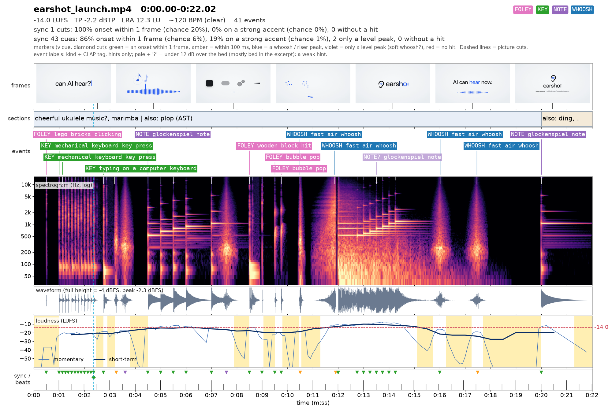

# earshot

earshot makes sound effects for a coding agent, which cannot hear them. The agent asks in words; earshot answers from
a catalogue of 922 designs, most of the realistic ones recorded things rebuilt in code, and renders a new take of the
best one. When the catalogue has no such thing, the answer says so plainly, and `earshot build` makes it from
recorded parts: the agent names the parts in words, earshot finds a recording for each, lays them out as a recipe and
listens to the result with its own ears (a listening model) to say how well it fits and what is still off. earshot
also listens to any sound file and describes it in words and numbers.

It is made for agents such as Claude Code, which write the code of interfaces, games and films, and for the people
who work with them. It runs on your own computer's CPU as a command line, a Python package, an MCP server and a
Claude Code plugin, and every sound it makes is yours to use.

```
$ earshot make "three variations of a footstep on gravel" -o step.ogg
step_1.ogg: step/pebbles (0.51 s, peak at 0.10 s, -15 LUFS, clean) [gravel, footstep]
step_2.ogg: step/pebbles (0.40 s, peak at 0.07 s, -16 LUFS, clean)
step_3.ogg: step/pebbles (0.60 s, peak at 0.02 s, -16 LUFS, clean)
played: one event; the action: events=<n> or say it ("footsteps", "knocking", "three knocks")
also: step/gravel, step/floorboard, step/heels
```

The three files are three different real footsteps: `step/pebbles` is learned from recordings of steps on gravel
that are in the public domain, and each file is a new take rendered from them. What the catalogue lacks, the agent
builds with `earshot build`: [Build what is missing](#build-what-is-missing).

```bash
npx skills add Leonxlnx/earshot                                   # the agent skills
pip install "earshot @ git+https://github.com/Leonxlnx/earshot"   # the tool
```

Install from GitHub: the name `earshot` on PyPI belongs to another project.

[The earshot site](https://leonxlnx.github.io/earshot-site/) plays all 922 sounds in the browser.

What is in the box:

- **Making sounds** (`earshot make`): a catalogue of 922 designs in 384 families holds interface sounds, everyday
  foley, ambience beds, game sounds, chip sound, drums, film and motion effects and three short music loops. 309 are
  learned from 692 recordings in the public domain; no audio file is in the repository, and every sound is rendered
  by code when it is asked for. Ready-made sets give an app, a game or a film its sounds in one call.
- **Building what is missing** (`earshot build`, recipes): a sound made of recorded parts, laid out as a small JSON
  recipe (scattered, repeated, bent in pitch, passing by, pulsing, drawn longer), heard and tuned by the listening
  model. A cookbook of 99 recipes ships with it.
- **Listening** (an extra): what a file sounds like, how well it fits a description, the best moment in a long
  recording, whether it sounds recorded or synthesized, and a second-by-second account of a film's soundtrack.
- **Tools for film sound**: a bank of 252 sound effects stored as code, film sound kits, a search that writes
  synthesis code by listening (`forge`), and `fit`, which turns a recording into code.
- An MCP server with 20 tools, a Claude Code plugin with two commands, and two agent skills.

## Contents

- [Install](#install)
- [Make sounds](#make-sounds): how to ask, what it can make, sets for an app, a game or a film, files
- [Build what is missing](#build-what-is-missing): `earshot build`, parts in words, recipes
- [Listen](#listen)
- [Film sound: bank, kits, forge, fit](#film-sound-bank-kits-forge-fit)
- [Use it from an agent](#use-it-from-an-agent): MCP server, Claude Code plugin, Python, skills
- [How good is it](#how-good-is-it) and [limits](#limits)
- [History](#history), [repo map](#repo-map), [licence](#licence)

## Install

Python 3.10 or newer, CPU only; no GPU is used. ffmpeg on PATH is needed only to write ogg, mp3, m4a and webm (wav
and flac are written without it) and to read video.

The base install makes sounds: `make`, `make_set`, `sounds`, recipes, the sound bank and film kits, and `pack`, on
the command line, in Python and as MCP tools. It brings numpy, scipy, soundfile, soxr and numba (about 350 MB
installed) and no model; nothing is downloaded when a sound is made.

```bash
pip install "earshot @ git+https://github.com/Leonxlnx/earshot"
earshot make "a soft success sound" -o success.wav
```

The first sound of a fresh install takes longer: numba compiles the synthesis loops once and keeps them on disk, so
later calls start at once.

Listening, measuring and drawing come with extras, named in the brackets (several at once: `earshot[listen,mcp]`):

| extra | brings | for |
|---|---|---|
| `mcp` | the MCP SDK | `earshot mcp`, the MCP server and the plugin |
| `listen` | torch, transformers, librosa; the two listening models (about 1.1 GB to download, about 2.2 GB on disk) download on first use | `describe`, `match`, `rank`, `find`, `compare`, `ab`, `realness`, `timeline`, `critique`, `profile`, `make --listen`, the ears of `build` |
| `measure` | librosa | `measure` and `find` without the models |
| `images` | matplotlib, pillow | `sheet`, `gallery`, frames of a video, plots |
| `llm` | requests | the optional Gemini critique (`earshot llm`, your own API key) |
| `all` | every extra above | |

A call that needs an extra that is not installed stops with one sentence that names the missing package and the
`pip install` command that adds it; `earshot doctor` lists what is installed. torch from the default index is large
on Linux (it brings CUDA); the CPU build is smaller:

```bash
pip install torch --index-url https://download.pytorch.org/whl/cpu    # before the listen extra, optional
pip install "earshot[listen,mcp] @ git+https://github.com/Leonxlnx/earshot"
earshot doctor --fetch     # downloads the listening models now (about 1.1 GB; 2.2 GB on disk), not on first use
```

As a uv tool, with the extras in the brackets (uv takes torch from the CPU index); update with `uv tool upgrade
earshot`:

```bash
uv tool install "earshot[mcp] @ git+https://github.com/Leonxlnx/earshot"
```

To work on earshot itself, install from a clone:

```bash
git clone https://github.com/Leonxlnx/earshot && cd earshot
python -m venv .venv
.venv/bin/python -m pip install torch --index-url https://download.pytorch.org/whl/cpu   # Windows: .venv/Scripts/python
.venv/bin/python -m pip install -e ".[all,dev]"
.venv/bin/python -m earshot doctor --load
```

**The listening models.** The first listening call downloads two open models (about 1.1 GB to download, about 2.2 GB
on disk) into `.cache/hf` inside a clone, `~/.cache/earshot/hf` otherwise (or `EARSHOT_HOME`), each at a pinned
revision with safetensors weights: CLAP `laion/larger_clap_general` @ `16c8cc3` (text-audio embeddings) and the
AudioSet tagger `MIT/ast-finetuned-audioset-10-10-0.4593` @ `f826b80`. After that earshot loads them from that
cache only and never contacts the Hub; a damaged cache is an error that names the folder, not a silent new
download. A cache made before 0.2.1 holds CLAP's revision `ada0c23` as a pickle; earshot still loads it, never
downloads it, and `earshot doctor --fetch` replaces it with the pinned safetensors (776 MB).

**Offline.** `EARSHOT_OFFLINE=1`, `HF_HUB_OFFLINE=1` and `TRANSFORMERS_OFFLINE=1` all mean the same to earshot: it
never downloads, and a model missing from the cache is an error that says so. earshot never sets or clears them.

**Settings** (environment variables): `EARSHOT_THREADS` (torch CPU threads, default min(4, cores/2); the CLI and the
MCP server hold numpy and scipy's OpenBLAS to it too, unless `OPENBLAS_NUM_THREADS` is set), `EARSHOT_HOME` (the
cache root), `EARSHOT_PRECISION` (`bf16` by default, used only on CPUs with native bf16 such as AVX512-BF16 or AMX,
fp32 everywhere else; `fp32` forces fp32), `EARSHOT_CLAP` / `EARSHOT_AST` (another Hub model id, or a local model
folder with `config.json` and `model.safetensors`, loaded from disk as it is) and `EARSHOT_CLAP_REVISION` /
`EARSHOT_AST_REVISION` (another Hub revision; safetensors weights only). `earshot doctor` reports the revisions and
what the cache holds; `--load` also what loads.

## Make sounds

`earshot make` reads a request, ranks the catalogue, renders a new take of the best design, checks it without models
(clicks, cut tails, clipping, DC) and writes the file. It loads no model and takes a few seconds for a one-shot.

```
$ earshot make "a soft success sound for a finance app" -o success.ogg
success.ogg: success/shutter (0.36 s, peak at 0.10 s, -15 LUFS, clean) [success]
also: complete/shutter, success/click, complete/chop

$ earshot make "a campfire" -o fire.ogg --dur 24
fire.ogg: fire/camp (24.00 s, peak at 19.96 s, -22 LUFS, seamless loop, clean) [campfire]
also: fire/large, fire/small, fire/whoosh
```

The first line of each file is the result: the design chosen, the length, where the loudest moment is (`peak at`),
the loudness, `seamless loop` for a loop, `clean` or what the check found, and the words that decided. `also` gives
three alternatives, to be taken with `--sound ID`. A request that names something the catalogue does not have still
gets a file, and the answer says so: `earshot makes no fire alarm; timer/done is only the nearest sound it has`,
with three starting points and the `earshot build` line that builds it. Lines such as `not followed`, `not in this
sound` and `not understood` name what the request asked that this sound does not do. Every line and option:
[docs/MAKE.md](docs/MAKE.md).

### How to ask

Name the thing, the job or the sound first; then feelings, material and numbers.

| the words | what they do | example |
|---|---|---|
| the thing, the job or the sound | choose the design: things ("a light switch", "a cork"), jobs ("success", "coin pickup", "toggle") and sounds ("chime", "whoosh", "rain") | `"a notification"` -> `notify/knock` |
| feelings | offsets on eight shared axes: bright, hard, ring, size, space, width, energy, motion | `"a much bigger, darker whoosh"`: size +0.84, bright -0.6 |
| negation, comparison | "not harsh", "not too loud", "the opposite of a success sound", "like a ..." | `"the opposite of a success sound"` -> `error/knock` |
| a surface or a place | what follows "on" or "in" is where the sound happens; a surface it lacks gets the nearest and says so | `"rain on a tarp"` -> `rain/tent`, "the nearest surface" |
| one event or the action | a plural, an action word, a count or a length plays the action a person performs; a singular or "a single" one event | `"footsteps on gravel"` (a walk), `"a footstep on gravel"` (one step), `"three knocks"` |
| voice | the instrument that plays a tonal sound, when the words ask for music | `"a notification on a harp"`, `"a kalimba note in E"` |
| material | picks the voice of a tonal sound (wooden: a marimba) and steers the ranking; "8-bit", "retro", "chiptune" allow only chip sound | `"8-bit coin pickup"` -> `coin/chip` |
| numbers | length, gap, pitch, key, how many takes, how many events | `"400 ms"`, `"200 ms apart"`, `"in D minor"`, `"three variations"` |
| loop or not | ambience loops by default; "no loop" or `--no-loop` renders it once with fades | `"rain on a tent, no loop"` |

The moment may follow the sound ("a soft thump when the pricing card settles"); words for the place or the product
("in my running app, a success sound") choose nothing. A request in German is read through a table of common sound
words ("Regen auf Holz" as rain on wood); other languages get "write it in English". Options win over the words:
`--pitch`, `--dur`, `--voice`, `--events`, `--lufs` and the axes `--bright` ... `--motion` (each -1 to 1), and
`--sound ID` takes a design by name. To steer, ask again with adjectives ("softer", "drier", "longer") rather than
browsing.

### What it can make

`earshot sounds` lists every design (`--search`, `--domain`, `--family` narrow it). Ids are `family/name`: what the
sound is, then its character.

| group | designs | how it is made | examples |
|---|---|---|---|
| learned things | 309 | learned from 692 recordings in the public domain: footsteps, doors, switches, keyboards, glass, water, animals, people without words, street, house and kitchen sounds | `step/pebbles`, `door/shut`, `switch/lamp`, `camera/shutter`, `dog/bark`, `rocket/launch` |
| interface | 29 | things a hand does, built from those recordings: a key going down and coming up, a page, a drawer, a cork, knocks, a camera shutter, scissors | `toggle/key_down`, `next/page`, `notify/knock`, `success/shutter`, `delete/snip` |
| interface and game figures | 45 (and 3 ticks) | notes in time on a real instrument (a marimba by default); for interfaces only when the words ask for music or a theme is named | `success/rise`, `coin/bright`, `level_up/fanfare`, `logo/bloom` |
| ambience | 43 | 25 learned from recordings of real places and textures, 18 from rules | `fire/camp`, `waves/sand`, `rain/tin_roof`, `cafe/busy`; `rain/window`, `forest/morning` |
| film and motion | 69 | 55 built from learned recordings as motion films use them (small real actions cut short: a door falling shut, a heavy bag dropped, a stick swung, a breath of air; hits, whooshes and risers); 14 small ones invented | `thump/door`, `title/bag`, `logo/bag`, `whoosh/sweep`, `rise/breath` |
| drums | 40 | 33 played from recorded strokes in the public domain (the acoustic kit and hand percussion); 7 invented | `kick/soft`, `snare/tight`, `conga/muted`; `kick/electro` |
| chip | 24 | the channels of 8-bit consoles; only when asked for | `coin/chip`, `jump/chip`, `laser/chip` |
| action and objects | 83 | invented from physics | `jump/soft`, `hit/punch`, `coin/drop`, `bell/desk` |
| notes and synthesizer | 51 and 14 | real instruments learned note by note, struck and string models, synth patches | `note/kalimba`, `pad/warm` |
| music loops | 3 | short beds for a game menu or a demo; earshot does not make music | `bed/warm`, `bed/playful`, `bed/8bit` |
| bank | 209 | the film sound bank, stored as code | `whoosh_fast/crisp`, `riser/tension` |

When a learned design and an invented one answer the same request, the learned one wins. When the two are the same
thing (`knock/door` and `door/knock`: 34 such pairs), a request that names the thing gets the learned one, and the
invented one is still there by its id.

**Learned sounds.** A learned design is not a recording that is played back. earshot keeps each recording as numbers
(the level of 56 bands every 2 ms, how tonal each band is, the stereo image) and renders a new take from them with
fresh noise and the request's controls. Seeds 0, 1, 2 walk through a design's recordings, the fullest clean one
first. A thing a person does several times in a row (a walk, a knock, typing, coins) is played as that action when
the words ask for it. Every recording is credited in a `CREDITS.md` next to its numbers ([Licence](#licence)).

### Sets for an app, a game or a film

A ready-made set makes the sounds a kind of product needs in one call, with a `manifest.json`: `ui` (17 interface
sounds), `game` (22: menus, rewards, jingles, actions), `arcade` (16 chip sounds) and `film` (17 motion-design
sounds). Every one-shot of a set is as loud as it is made alone, turned down only so that none lies more than 2.5 dB
over the quietest. A JSON spec adds your own sounds to a set or lists only your own (`earshot make --spec
sounds.json`, MCP `make_set`).

```
$ earshot make --set ui -o public/sounds --format webm,mp3 --sprite sprite
17 sounds in public/sounds (webm, mp3), manifest.json
tap.{webm,mp3}: keyboard/mechanical (0.32 s, peak at 0.02 s, -18 LUFS, clean) [named]
hover.{webm,mp3}: hover/fingertip (0.34 s, peak at 0.07 s, -22 LUFS, clean) [named]
toggle_on.{webm,mp3}: toggle/key_down (0.24 s, peak at 0.03 s, -19 LUFS, clean) [named]
...
success.{webm,mp3}: success/shutter (0.36 s, peak at 0.10 s, -15 LUFS, clean) [named]
error.{webm,mp3}: error/knock (0.58 s, peak at 0.19 s, -18 LUFS, clean) [named]
17 sounds in public/sounds\sprite.webm + sprite.mp3 (11.7 s, 101 kB, 183 kB), map sprite.json
```

Every sound of `ui` is a thing a hand does, with no instrument: a mechanical key for a tap, a page for next and
back, a drawer for open and close, a camera shutter for success, knocks for a notification, a warning and an error.
A plain interface request ("a success sound", "a notification") gets the same design. A theme (`soft`, `glass`,
`wood`, `felt`, `tine`, `metal`, `electric`, `digital`, `retro`, or a dict such as `{"base": "wood", "key": "D"}`)
gives a family one voice, key and room; with a theme named, `ui` plays tonal figures in that voice instead.

`film` is cut to measurements of professional motion videos and plays small real actions, no instrument: a door
falling shut when something appears (`pop`, `thump/door`), the top of a mechanical key for a tick (`tick/key`), a
heavy bag dropped under a title and a logo (`title/bag`, `logo/bag`), a stick and a broom through the air
(`whoosh/fast`, `whoosh/sweep`), a page sliding (`slide/paper`), a car door for an impact (`impact/car`), a breath of
air rising (`rise/breath`), a sword drawn for a glint (`shine/blade`). The table of roles and the spec:
[docs/MAKE.md](docs/MAKE.md#a-whole-set).

### Files

- **Formats**: the extension picks it: wav and flac directly; ogg, webm, m4a and mp3 through ffmpeg. For the web
  write `webm,mp3`: Ogg Vorbis does not play in Safari before 18.4. 48 kHz stereo, or `--mono`.
- **Sprites**: `--sprite sprite` on a set, or `earshot pack FOLDER -o sprite.webm`, lays every sound in one file with
  a map in the format howler.js reads.
- **Loops**: ambience beds and music loops are seamless; a learned bed is stitched from pieces of its recording and
  has no loop point at all. `--dur` sets the length, "no loop" or `--no-loop` renders it once with fades. Write
  loops as ogg, webm, wav or flac: an mp3 or m4a loop has a gap at its seam in many players.
- **Loudness**: a single sound peaks at -1 dBFS true peak and no louder than -14 LUFS momentary (ambience beds -22,
  music loops -16); `--lufs` sets it. A set levels its sounds against each other.
- **Takes**: the same arguments give the same samples; `--seed` and `--n` give other takes.

How each engine works (learned sounds, stitched beds, real instruments, performances, drums, chip, rooms):
[docs/MAKE.md](docs/MAKE.md#the-engines).

## Build what is missing

`earshot build` makes a sound the catalogue lacks out of recorded parts, with earshot as the ears. An agent that knows
what makes the sound names the parts in plain phrases; earshot finds a recording for each, writes its layer from the
words (how many, when, how long, moving, getting louder, lower, far) and says which design each part became and which
words it did not understand. Without `--part` it drafts the parts itself from the words. It renders the recipe, hears
it with the listening model, tunes its numbers in a seeded search, and writes `x.wav` and `x.recipe.json`.

```
$ earshot build "a stampede of horses" -o stampede.wav --part "hundreds of hoofbeats, for 6 s, getting louder" --part "a low rumble under everything, soft" --part "a horse neighing, twice, far"
stampede.wav: recipe/a_stampede_of_horses_parts (8.53 s, peak at 6.20 s, -14 LUFS, clean) [built]
built from: horse/trot (scattered 26.2 a second over 6 s, its level drawn: -18, +0 dB); thunder/roll; horse/neigh (2 times, under 3915 Hz)
part 1 'hundreds of hoofbeats, for 6 s, getting louder': horse/trot (scattered 26.2 a second over 6 s, its level drawn: -18, +0 dB); horse/trot names 'hoofbeats' in its own words (atlas and own words +3.4, a short take to repeat); next nearest: heart/beat, whisk/beat, step/floorboard
part 2 'a low rumble under everything, soft': thunder/roll; thunder/roll names 'low rumble' in its own words (atlas and own words +3.2, a long take for a bed); next nearest: roll/drum, explosion/far, cat/purr
part 3 'a horse neighing, twice, far': horse/neigh (2 times, under 3915 Hz); horse/neigh names 'horse neighing' in its own words (atlas and own words +6.6, a short take to repeat); next nearest: cow/moo, elephant/trumpet, bear/growl
heard as: horse/neigh, wolf/howl, wind/window; words: 'a horse neighing' (z +4.1), 'a gust of wind rushing past' (z +3.2), 'a cow mooing' (z +3.1); second ear: Neigh, whinny 0.92, Horse 0.71, Animal 0.57, Clip-clop 0.25
fit: z +3.72 for 'a stampede of horses' (the nearest design horse/neigh: z +2.61): sounds like it; recorded: p_real 0.97
tuned in 20 rounds: layer 0 (horse/trot) scatter.rate 16.5 -> 26.2; layer 0 (horse/trot) scatter.pitch 2 -> 1.33; layer 0 (horse/trot) scatter.gain 6 -> 9.4; layer 1 (thunder/roll) dur 6 -> 5.04 ...; fit z +3.16 -> +3.72
still off: nothing the measures find; a person should listen once
next: edit stampede.recipe.json, then: earshot build "a stampede of horses" --recipe stampede.recipe.json
```

The first try had the rumble at its full level. It came back "a sketch" (z +3.56), and its `still off` line said that
the thunder covered the rest and to lower its gain by about 6 dB; the word "soft" in the second part did that.

`fit` is the listening model's z for the words beside the design `make` would hand over. "sounds like it" needs the
sound clean, a z of at least 3.0 and 1.0 over that design, and no objection from a second ear (the AudioSet tagger),
which the tuner never sees; otherwise it is "a sketch". `still off` names the recipe field to change, and `earshot
build "..." --recipe x.recipe.json` hears an edited recipe again. A build takes about a minute; without the listen
extra it drafts, renders, audits and measures, and says that it did not hear. No model generates audio: the
listening models only judge. The loop, the phrase grammar and what it cannot do: [docs/BUILD.md](docs/BUILD.md).

**Recipes.** A recipe is the small JSON form a build writes, and an agent can write one by hand: layers of the
catalogue's recordings, moved in pitch, cut, filtered, repeated, scattered (one clap becomes applause), drawn over
time in level and pitch, carried past the listener, pulsing or drawn longer, with noise for air and a low sine for
weight (`earshot recipe --example` prints the form; `earshot make --recipe roar.json -o roar.wav` renders it). The
cookbook (`earshot recipe --list`) holds 99 recipes: 59 answer a request for their thing on their own, and 40 are
sketches that an answer names only as a starting point. When the catalogue has a recording of the thing itself, the
recording answers.

```
$ earshot make "a car crash" -o crash.wav
crash.wav: recipe/car_crash (3.11 s, peak at 1.58 s, -14 LUFS, clean) [recipe]
built from: tyres/screech; car_door/slam (-7 semitones); metal/drop (-5 semitones); glass/break; can/drop (-3 semitones)
built from parts by the cookbook recipe car_crash: no design of the catalogue is this sound; `earshot recipe car_crash` prints the recipe to change; the nearest designs: impact/car, boom/door, slam/door (sound=<id>)
```

Every field of a recipe: [docs/MAKE.md](docs/MAKE.md#when-earshot-has-no-such-sound-build-it).

## Listen

Listening needs the `listen` extra. Every command prints a plain-language summary first; `--json` gives the full
result and `--out f.json` saves it.

| command | what an agent gets |
|---|---|
| `describe FILE` | what it sounds like: calibrated tags (z) with the closest alternative readings, AudioSet labels, measurements |
| `match FILE QUERY [--alts ...]` | how well a description fits: a z among the vocabulary and a verdict (strong, plausible, weak, no match) |
| `rank QUERY PATHS...` | many candidate files sorted by a description |
| `find FILE QUERY` | the best moments inside a long recording, as trims (start and end in seconds) |
| `compare FILE --refs DIR` / `ab A B` | the nearest reference recordings and typicality; two sounds compared, the differences in words |
| `realness FILE...` | real recording or professionally produced, against code-synthesized, with evidence |
| `timeline FILE [--video V] [--cues C]` | events with time, level and tag, sections, loudness, beat grid, sync of sound to picture cuts and cues |
| `sheet FILE -o out.png` | an annotated picture (frames, sections, events, spectrogram, loudness, sync) for agents that read images |
| `critique FILE [--video V]` | a launch-film scorecard against a profile of 7 professional launch films, with timestamped fixes |
| `profile REFS... -o p.json` | your own reference profile from films you admire |
| `measure FILE` | measurements only, no models: LUFS, true peak, LRA, envelope, spectrum, tempo and key |
| `doctor [--load]` | the install, the models, the data files and the CPU settings |
| `llm FILE --yes-upload` | an optional critique by an audio language model (Gemini), only with your own key and your consent |

Each CLI call is a new process and loads the models first (about 20 to 40 s); `make`, `sounds`, `recipe`, `pack`,
`measure`, `sfx` and `kit` load none. For more than a few listening calls use the MCP server, where the models stay
loaded, or one Python script with `from earshot import api`. Errors are one line on stderr (`earshot <command>:
error: ...`, exit 1).

```
$ earshot match key.ogg "a deep thocky mechanical keyboard press" --alts "a clicky blue switch keyboard" "a mouse click"
  -> strong (z +3.7; would rank #2 among 322 vocabulary descriptions) ...

$ earshot find keys.ogg "a single mechanical key press" --top 4
  0:03.94-0:04.19 (0.24 s stroke, z +4.1 strong); 0:10.60-0:10.86 ...
```

What an agent sees when it listens to a film with `earshot sheet`:



## Film sound: bank, kits, forge, fit

**The bank and kits** (`earshot sfx`, `earshot kit`; no models, no network). 252 sound effects for code-made films
render by id: 183 made by the forge in 34 categories, 51 made for films cut to music (`ui_pop`, `knock`, `cut_hit`,
`mallet`, `drip`, `shutter`, `reverse_swell`), three tuned kalimba voices and 15 fitted from CC0 recordings
([docs/CREDITS_FIT.md](docs/CREDITS_FIT.md)). Their 209 named members are also in the `make` catalogue. Knobs set a
length, the time of a whoosh's loudest moment and a pitch; every render is checked. A kit names one sound per role and
renders cached takes with their measured onset, peak and end; the `launch` preset sets each role's level over the
music and its place against the cut, from measurements of professional films.

```bash
earshot sfx render whoosh_fast/crisp -o w.wav --dur 0.8 --apex 0.32  # a new take aimed at a move
earshot kit init --preset launch -o audio/kit.json                   # calm | crisp | minimal | launch
earshot kit render audio/kit.json --out audio/kit                    # takes + kit.lock.json
```

Every knob, the check, the kit and lock formats and the presets: [docs/SFX.md](docs/SFX.md). How the cinetic skill
uses them: [docs/INTEGRATION.md](docs/INTEGRATION.md#cinetic-uses-earshot).

**forge: search by listening.** An agent writes a sound as code, a recipe of physical synthesis with no recorded
audio inside. The forge renders candidates from the recipe's parameters, a critic built from earshot scores each one
against named confusions and real reference recordings, model-free measurements (tonal balance, envelope, artifacts)
penalise what the models miss, and an evolutionary search keeps the best. The agent reads the critic's words, looks
at the spectrograms next to the references, rewrites the recipe and runs it again. `earshot gallery` turns the
results into one static listening page. Every number and what is still weak: [docs/FORGE_V2.md](docs/FORGE_V2.md).

```bash
earshot forge --list
earshot forge keypress --refs path/to/real/keypresses/ --budget 144 --variants 4 --dir made/keypress
earshot gallery out/forge_v2 -o out/gallery/gallery.html     # <category>/final/*.wav, one card per category
```

The reference recordings are licensed and not in this repository: bring your own with `--refs DIR`. Without them the
critic runs in designed mode.

In a blind test of five forge sounds next to real recordings, one listener picked the made one 8 times out of 15,
which is chance. The search optimises earshot's own models, which can be pleased without the sound getting better:
judge a forged sound by the model-free measurements, spectrograms next to the references and a human blind test.

**fit: audio to code.** `earshot fit` fits a small synthesis model with readable parameters (ringing modes, tracked
partials, a noise gesture, or layers of them) to a recording and writes it as a forge recipe module that renders new
takes, variations and morphs. A fit is a derivative of its recording, so it keeps the source's licence. The
measurements, the replication benchmark against professional sound effects and the limits: [docs/FIT.md](docs/FIT.md).

```bash
earshot fit click.wav -o made/click_fit.py --report
earshot fit --morph a.wav b.wav --amount 0.5 -o made/ab_morph.py
```

## Use it from an agent

### MCP server

The server needs the `mcp` extra; its making tools need nothing more, and the listening tools need the `listen`
extra (they answer with the install command until it is there).

```bash
claude mcp add earshot --scope user -e EARSHOT_THREADS=3 -- earshot mcp     # uv or pip install
claude mcp add earshot --scope user -e EARSHOT_THREADS=3 -- /path/to/earshot/.venv/bin/python -m earshot mcp   # clone
```

Or in any client's `.mcp.json`:

```json
{"mcpServers": {"earshot": {"command": "/path/to/earshot/.venv/bin/python", "args": ["-m", "earshot", "mcp"],
  "env": {"EARSHOT_THREADS": "3"}}}}
```

The 20 tools: `make` (a request, or a design by id, or a recipe), `make_set` and `sounds` (no models); `build` (with
`parts`; its ears need the `listen` extra); `measure`, `describe`, `match`, `rank`, `find`, `compare`, `ab`,
`realness`, `timeline`, `sheet`, `critique`, `doctor` and `llm_critique`; and the bank, `sfx_list`, `sfx_render` and
`kit_render`. Models load on the first listening call and stay loaded; once they are, `make` also ranks by how the
designs sound and `build` does not load them again. On a slow machine start Claude Code with
`MCP_TIMEOUT=60000`. The optional `llm_critique` tool reads `GEMINI_API_KEY` from the environment; never write a key
into a file.

### Claude Code plugin

The repository is also a Claude Code plugin and its own marketplace. Install the tool first with the `mcp` extra
(above): the plugin starts the `earshot` on your PATH and installs nothing itself. Then, in Claude Code:

```
/plugin marketplace add Leonxlnx/earshot
/plugin install earshot@earshot
```

It brings the two skills, the MCP server (`earshot mcp` with `EARSHOT_THREADS=3`; skip `claude mcp add` then) and
two commands: `/earshot:make WORDS` makes one sound into the project, `/earshot:make-set ui|game|arcade|film [theme]`
a whole set.

### Python

```python
from earshot.make import make, make_set
make('a door shutting', 'door.wav')                                    # the same result as the CLI, as a dict
make_set('ui', out='public/sounds', fmt='webm,mp3', sprite='sprite')
from earshot.build import build
build('a stampede of horses', out='stampede.wav', parts=['hundreds of hoofbeats, for 6 s, getting louder'])
from earshot import sounds as catalogue
y, meta = catalogue.render('step/heels', seed=1)    # stereo float64 at 48 kHz; meta['member']: which recording

import earshot
earshot.describe('whoosh.wav')
earshot.find('typing.ogg', 'a single isolated key press')
from earshot import api   # everything in one namespace: api.make, api.rank, api.critique, api.realness_many, ...
```

### Agent skills

Two skills ship in `skills/`. `npx skills add Leonxlnx/earshot` installs them; or copy them into `~/.claude/skills/`
(or a project's `.claude/skills/`).

- **`skills/earshot`**: how an agent makes sounds with earshot (when a page, a game or a film needs a sound, how to
  ask, how to read the answer, how to build what is missing) and how it listens: which command answers which
  question and when not to trust it.
- **`skills/real-sound`**: a process for realistic soundtracks for code-made films from real licensed recordings:
  sourcing with licence checks, a music edit, a JSON sound design, a mixer, measured checks, mastering, credits and
  mux. earshot chooses, trims and verifies the sounds.

## How good is it

Every number below comes with its method in [docs/VALIDATION.md](docs/VALIDATION.md).

- **Made sounds.** No listening model decides whether a made sound is good: earshot's own models did not predict
  how a person rated its sounds. The sounds were judged by ear by the maintainer on listening pages that were not
  blind. Takes of learned recordings were judged as good as the recordings themselves; chip sound, the soft tonal
  figures, rain on a window and the forest bed passed. Sounds invented from formulas for real things (footsteps,
  punches, explosions, doors), most music beds, the drums invented from physics and bell or glass timbres for
  interface sounds failed, which is why realistic sounds are learned from recordings now. The sounds built last (the
  interface set, the film and motion hits, the newer learned things and beds, the recipes and builds) have been
  measured but not yet judged by anyone.
- **Builds**, judged by the listening model, not by a person: rebuilt from other recordings, things the catalogue has
  came out near their real design for textures of many similar events and for pulsing (a purr, a swarm, a boiling
  pot, a campfire); `earshot build applause` prints "a sketch: not clearly it yet" (z +4.69 against +4.50 for the
  catalogue's applause, 1.0 more is asked); rain and hail on a new surface and a vehicle passing built from another
  motor did not.
  For 30 things the catalogue lacks, 29 builds fit the words better than what `make` hands over
  ([docs/BUILD.md](docs/BUILD.md#how-well-it-does)).
- **Understanding requests.** On five development sets the first pick is right for 91.8 to 96.8 % of the requests
  and one of the top three for 95.9 to 99.1 %. On 220 held-out requests written by someone who never saw the
  catalogue, scored once on an earlier reader, 69.1 % and 76.4 %. Requests that name the thing or the job do far
  better than descriptions of a mood.
- **Matching descriptions** (125 held-out real recordings): a "strong" verdict is the right kind of sound 98 % of the
  time and the exact variant 61 % of the time.
- **Real against code-synthesized**: held-out ROC-AUC 0.92 with whole sound families held out; firm verdicts call
  6.7 % of real clips synthesized and 5.5 % of synthesized clips real.
- **Listening through a soundtrack**: 93 % of the sound effects in a 60 s film mix are found as events (89 % of the
  quiet ones under music). A 60 to 90 s film takes about 1.5 minutes on a laptop CPU.
- **Launch scorecard**: each reference film critiqued against the other six falls in range on 86 % of the metrics
  (the no-overfit baseline is about 71 %).

## Limits

`make` chooses and shapes designs from a fixed catalogue. It makes no speech, singing or melodies, and plays
instruments only as single notes and short figures; realistic sounds exist only for things someone recorded and put
in the public domain. A request that describes a mood is understood less well than one that names the sound, and a
pick without a guess line can still be wrong. `build` is not a way to any sound: it works for textures of many
similar events and for pulsing (a swarm, a campfire, a purr; applause stays a sketch), not for rain or hail on a
new surface, a vehicle passing built from another motor, voices or pure tones; its fit comes from a listening
model, not a person's ear, and the second ear also objects to some real recordings. earshot hears through two
open models and a set of measurements: loudness, timing and "is this the kind of sound I asked for" on single sounds
are trustworthy; tags inside a busy mix, genre and mood are hints; taste, emotion, licences and speech content it
cannot judge. Everything it does not make and cannot judge: [docs/LIMITS.md](docs/LIMITS.md).

## History

- **1.0** adds making sounds: `make`, `make --set`, `sounds`, `build`, recipes, `pack`, the catalogue learned from
  public-domain recordings, and the Claude Code plugin.
- **0.4** added the sound of music-led launch films to the bank (51 sounds, the `launch` kit preset) and re-made `fit`
  against professional sound effects. [The 0.4 launch film](https://github.com/Leonxlnx/earshot/releases/tag/v0.4.0)
  uses bank takes placed with the launch kit.
- **0.3** added the bank of sound effects stored as code (`sfx`, `kit`).
- **0.2** added forge v2 and `earshot fit`.
- **0.1** was the listening tools, the first forge, the MCP server and the two agent skills.

Every change: [CHANGELOG.md](CHANGELOG.md).

## Repo map

```
earshot/            the package: CLI, Python API, MCP server, CPU model wrappers
  make.py           earshot make / sounds: a request in words -> a design rendered and written; make_set for sets
  brief.py          reading a request: things, jobs, sounds, surfaces, feelings as axes, voice, numbers, key
  recipe.py         recipes: a sound built from the catalogue's parts
  build.py          earshot build: parts in words -> a recipe, rendered, heard and tuned
  pack.py           earshot pack: many sounds in one file with a howler-style map
  sounds/           the catalogue: registry, themes, sets, the lexicon, the design modules
  synth/            the engines: learned sounds, stitched beds, real instruments, performances, struck and string
                    models, synthesizer, drums, chip, textures, music; the shared rooms, finishing, file formats
  data/resyn/       the learned sounds: one model per recording (numbers), index.json, CREDITS.md
  data/textures/    the learned ambience textures; data/drums/ the drum strokes; data/notes/ the instrument notes
  data/recipes/     the cookbook
  forge/            make sounds in code by listening: DSP building blocks, critic, search; fit/, bank/, kits/
  gallery.py        the static listening page
skills/earshot/     agent skill: how to make sounds and listen with earshot
skills/real-sound/  agent skill: real-recordings soundtracks
docs/               MAKE, BUILD, VALIDATION, LIMITS, FORGE_V2, FIT, SFX, the motion-sound study, design notes
.claude-plugin/     the Claude Code plugin and its marketplace; commands/: /earshot:make, /earshot:make-set
eval/               evaluation scripts and results per area (see eval/README.md)
tests/              pytest: fast by default, no models; --slow loads the models and renders the long designs
```

No audio or video is stored in this repository. The learned sounds are numbers analysed from public-domain
recordings, not the recordings. The evaluation data (licensed recordings and third-party films) is not
redistributed; only derived numbers are committed.

## Licence

MIT for the code (see [LICENSE](LICENSE)). Everything earshot renders (`make`, `sfx`, `kit`, `forge`) belongs to
whoever rendered it: free for any use, commercial too, without credit. The learned sounds, beds, drums and instrument
notes come from recordings in the public domain (BigSoundBank, Kenney, VCSL, VSCO-2 CE, Karoryfer and CC0 uploads on
Freesound, all CC0 or an explicit public-domain dedication), each recording credited in
[earshot/data/resyn/CREDITS.md](earshot/data/resyn/CREDITS.md),
[earshot/data/textures/CREDITS.md](earshot/data/textures/CREDITS.md),
[earshot/data/drums/CREDITS.md](earshot/data/drums/CREDITS.md) and
[earshot/data/notes/CREDITS.md](earshot/data/notes/CREDITS.md); CC0 asks for no credit, and the files keep it
anyway. The bank's fitted sounds come from CC0 recordings ([docs/CREDITS_FIT.md](docs/CREDITS_FIT.md)); a fit you make
of your own recording carries that recording's licence. The models are downloaded from their authors under their own
licences: CLAP (`laion/larger_clap_general`) Apache-2.0, AST (`MIT/ast-finetuned-audioset-10-10-0.4593`)
BSD-3-Clause. `skills/real-sound/scripts/master.py` is vendored from the Cinetic skill by the same author.
